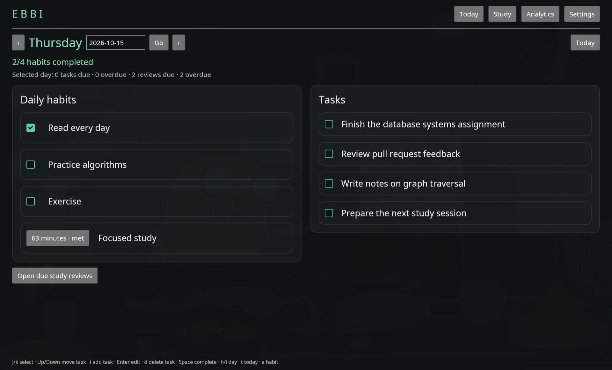
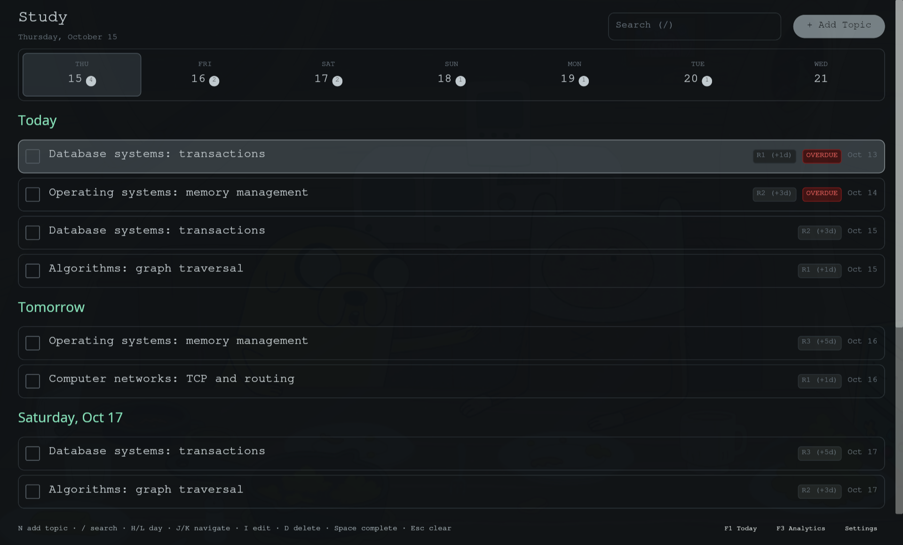
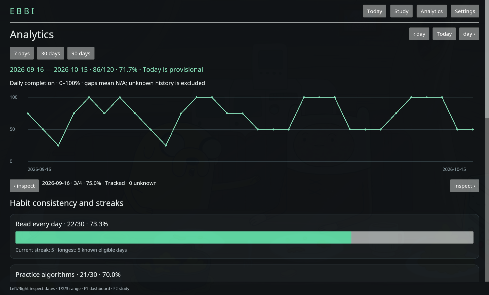
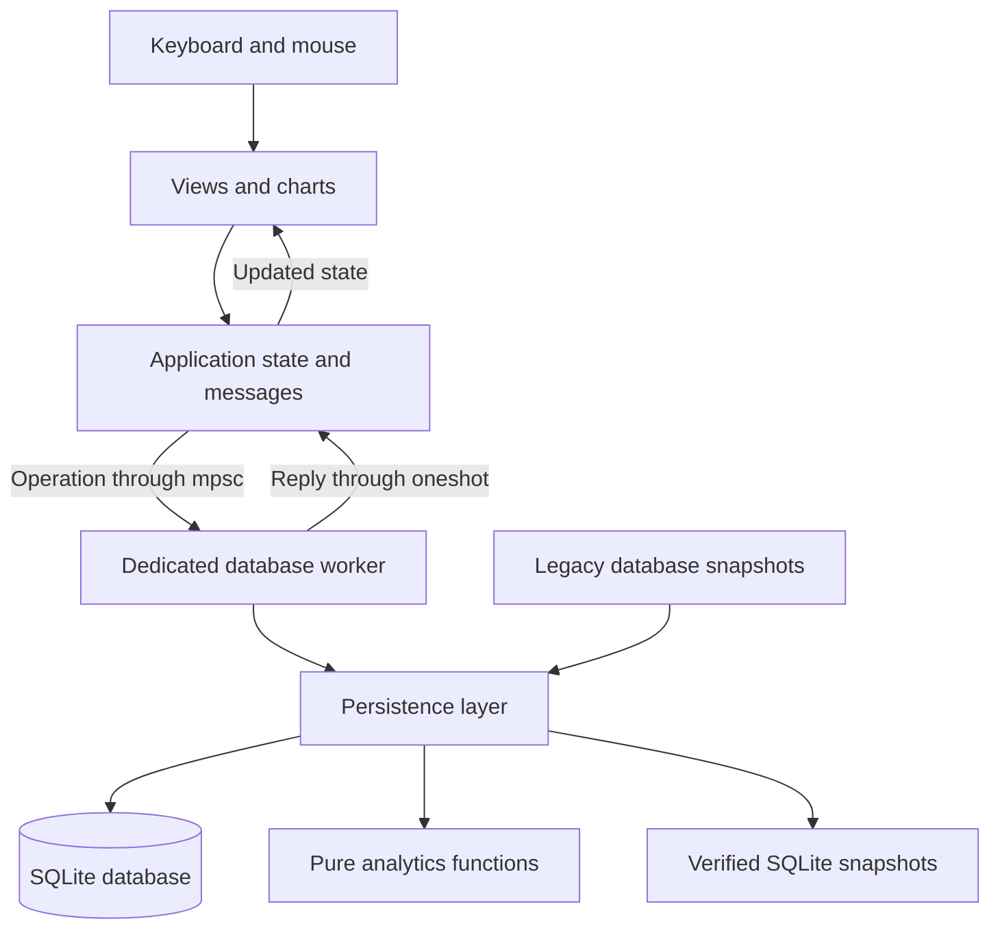

<div align="center">

# Ebbi

**Habits, tasks, and study reviews in one native Linux app.**

Built with Rust · Designed for daily use · Stored locally in SQLite


[Features](#features) · [Getting started](#getting-started) · [Architecture](#architecture) · [User guide](docs/usage.md)

</div>



## Overview

Ebbi brings recurring habits, everyday tasks, and spaced repetition into a single desktop application. Check in on a habit, record minutes spent studying, work through a review agenda, and see how your consistency changes over time.

The project combines the workflows of [Habit Tracker](https://github.com/Pierorivera1/Habit_Tracker) and [Repasito](https://github.com/Pierorivera1/Repasito) in a Rust application. Its engineering focus is straightforward: keep the interface responsive, preserve historical meaning, and make database failures visible. Core functionality works offline, without an account, server, or background service.

## Features

- **Daily dashboard:** binary and numeric habits, historical check-ins, task editing and reordering, and a summary of due study reviews. Columns stack on narrow windows.
- **Numeric goals:** minimum, maximum, and inclusive-range targets with named units. Goal changes take effect on a future date so earlier entries retain their original interpretation.
- **Study agenda:** searchable topics with Markdown notes, a seven-day date strip, overdue reviews, and independent review completion. Reviews follow fixed offsets of **1, 3, and 5 days** from the study date.
- **Useful analytics:** 7/30/90-day trends, consistency, current and longest streaks, numeric values against targets, complete-period comparisons, and study completion and on-time metrics.
- **History preservation:** archiving retains habit records; rescheduling preserves original review deadlines and records the change. Missing values and unknown legacy dates remain distinct from zero or failure.
- **Local data tools:** previewed imports from Habit Tracker and Repasito, transactional schema migrations, verified backups, and explicit storage errors.
- **Keyboard navigation:** view shortcuts, row selection, date navigation, and form controls alongside mouse interactions.

## Screenshots

Captured from the native app on Omarchy / Wayland. All names, tasks, and history shown here are synthetic demonstration data.

### Study agenda

A compact review list groups overdue, upcoming, and completed work. Search and date filtering can be used independently.



### Analytics

Calendar-aligned trends and per-habit statistics show the recorded history. Dates without eligible opportunities are reported as N/A.



## Getting started

### Requirements

- Rust **1.89 or newer** and Cargo.
- A Linux graphical session and working graphics driver. Native UI checks were performed on Omarchy / Wayland.
- The usual Iced Linux libraries, including `libxkbcommon` and Wayland support. A desktop portal enables the optional file chooser; typed paths are also supported.

SQLite is bundled through `rusqlite`; a separate database server is unnecessary.

### Build from source

```sh
git clone https://github.com/Pierorivera1/ebbi.git
cd ebbi
cargo build --release --locked
./target/release/ebbi
```

For an Arch/Omarchy package and desktop launcher, follow the
[installation guide](docs/installation.md).

### Open a specific view

```sh
./target/release/ebbi --view=dashboard
./target/release/ebbi --view=study
./target/release/ebbi --view=analytics
./target/release/ebbi --view=settings
```

To use a separate database for a demo or experiment:

```sh
./target/release/ebbi --db /tmp/ebbi-demo/ebbi.db
```

To populate a separate database with 90 days of synthetic history, follow the
[sample data guide](docs/sample-data.md).

After installation, open **Ebbi** from the application launcher. Run `--help` for options. Closing the window terminates the process.

Launching Ebbi again with the same database routes the requested view to the
already open window. Launching with a different `--db` path opens an independent
instance.

### Keyboard essentials

| Key | Action |
| --- | --- |
| `F1` / `F2` / `F3` | Dashboard / Study / Analytics |
| `J` / `K` | Select the next / previous row within the current column |
| `H` / `L` | Dashboard: select habits / tasks; Study: move between dates |
| `Space` | Toggle completion or enter a numeric value |
| `Enter` | Edit the selected item or save a form |
| `Esc` | Cancel a form or clear Study filters |
| `PageUp` / `PageDown` | Scroll the main view |

See the [user guide](docs/usage.md) for habit creation, task controls, review rescheduling, imports, and recovery instructions.

## Architecture

Ebbi separates presentation, application state, domain rules, and SQLite persistence. One worker thread owns the database connection and serializes storage operations; UI updates receive results asynchronously.



### Project structure

```text
src/
├── main.rs                 # CLI parsing and Iced startup
├── app.rs                  # Application state, messages, and interactions
├── ui.rs                   # Dashboard, settings, and shared styling
├── study_ui.rs             # Study agenda and topic forms
├── analytics_ui.rs         # Analytics view
├── charts.rs               # Canvas chart rendering
├── domain.rs               # Domain types and action/report contracts
├── analytics.rs            # Pure scheduling and analytics calculations
├── worker.rs               # Requests, replies, and database thread lifecycle
├── instance.rs             # Single-instance locking and view routing
└── persistence/
    ├── mod.rs              # Connection, transactions, snapshots, and backups
    ├── restore.rs          # Validated graphical backup restore
    ├── import.rs           # Legacy import validation and provenance
    ├── study_numeric.rs    # Study and numeric habit persistence
    ├── analytics.rs        # Queries and report assembly
    ├── schema.sql          # Initial schema
    └── v2.sql              # Numeric habits and review-date migration
tests/
├── storage.rs              # Persistence, imports, and backup integrity
└── study_analytics.rs      # Review behavior, numeric goals, analytics, migration
```

### Design decisions

**Native UI with a database worker.** Iced handles rendering and input. Blocking SQLite work and report calculation run on the owned worker thread, keeping those operations off the UI thread. Channels provide explicit request and response boundaries.

**Commit before reporting success.** Writes use transactions. The application distinguishes a failed write from a committed change whose subsequent refresh or backup failed. Storage startup failures remain visible rather than silently switching to an in-memory database.

**Historical rules are effective-dated.** Habit activation and numeric goals retain their applicable dates. Numeric entries are stored separately from binary check-ins, and missing entries remain missing. Review reschedules retain the original deadline and an audit record.

**Calendar dates and timestamps have different roles.** Habit entries and review deadlines use calendar dates. Completion timestamps represent instants; reviews also retain their local completion date when known. Analytics excludes unknown legacy facts instead of reconstructing them by guesswork.

**Imports preserve provenance.** Sources are opened read-only and snapshotted with SQLite's backup API, including WAL content. Validated rows are imported transactionally with their source identifiers and raw records. SHA-256 fingerprints detect identical imports, including copies at another path.

### Data model

| Area | Main tables | Purpose |
| --- | --- | --- |
| Habits | `habits`, `habit_rules`, `habit_entries` | Definitions, effective activation, and binary check-ins |
| Numeric tracking | `habit_goals`, `habit_values` | Effective goals and dated numeric observations |
| Tasks | `tasks` | Titles, ordering, completion state, and timestamps |
| Study | `study_topics`, `study_reviews`, `review_reschedules` | Notes, review stages, original deadlines, and schedule audit |
| Imports | `legacy_imports`, `legacy_rows` | Import identity and source provenance |
| Metadata | `settings`, `schema_migrations` | Database identity and ordered migrations |

## Technology stack

| Technology | Role |
| --- | --- |
| **Rust 2021** | Application, domain logic, worker, and persistence |
| **Iced 0.13** | Native UI, event handling, canvas charts, and Markdown preview |
| **SQLite + rusqlite 0.32** | Local storage, transactions, migrations, and snapshot backups |
| **chrono** | Calendar dates, timestamps, and review scheduling |
| **serde / serde_json** | Domain serialization, goal definitions, and imported raw records |
| **sha2** | Canonical import fingerprinting |
| **rfd** | Asynchronous native file dialogs through desktop portals |
| **GitHub Actions** | Formatting, Clippy, tests, and release build checks |

## Data and recovery

The default database is `$XDG_DATA_HOME/ebbi/ebbi.db`, or `~/.local/share/ebbi/ebbi.db` when the XDG variable is unset. `--db` selects a separate Ebbi database. An exclusive process lock prevents concurrent instances from writing to the same database.

Storage uses foreign keys, WAL mode, `FULL` synchronization, and bounded SQLite waits. Migrations create a verified permanent backup before upgrading an existing v1 database. Rolling backups and manual snapshots are verified before completion is reported.

Import and recovery details are in the [user guide](docs/usage.md#import). Original Habit Tracker and Repasito databases are preserved. Restore a backup through **Settings → Restore an Ebbi backup**; Ebbi validates it and saves a permanent pre-restore recovery snapshot. If Ebbi cannot open the current database, use the manual recovery steps in the [user guide](docs/usage.md#backups-and-recovery).

Archiving a habit keeps its history; confirming deletion removes the habit and its
binary and numeric history. Create a backup before deleting data you may need.

## Development

```sh
cargo fmt --all -- --check
cargo clippy --all-targets --locked -- -D warnings
TZ=America/Lima cargo test --all-targets --locked
cargo build --release --locked
```

Tests focus on observable behavior and data integrity: transactional rollback, import idempotency, backup validation, migration safety, review scheduling, missing versus zero values, historical goals, and hand-calculated analytics. Unit tests for app, worker, and CLI behavior live beside their implementation. Native UI checks use temporary synthetic data.

## Roadmap

The dashboard, Study, numeric tracking, analytics, imports, and backups are implemented. Local Arch packaging, desktop launchers, and a synthetic sample generator are available. Single-instance view routing and graphical backup restore are implemented. The package is built locally; release automation and formal startup and resource-use benchmarks remain outstanding.

Review scheduling uses fixed checkpoints; adaptive repetition, non-daily habit schedules, and cloud sync are outside the current scope.

## License

Available under either the [MIT license](LICENSE-MIT) or the
[Apache License 2.0](LICENSE-APACHE), matching the Cargo package declaration.

## Acknowledgments

Ebbi builds on the product workflows of [Habit Tracker](https://github.com/Pierorivera1/Habit_Tracker) and [Repasito](https://github.com/Pierorivera1/Repasito). README presentation takes inspiration from [Lapce](https://github.com/lapce/lapce), [Zed](https://github.com/zed-industries/zed), and [bat](https://github.com/sharkdp/bat).
